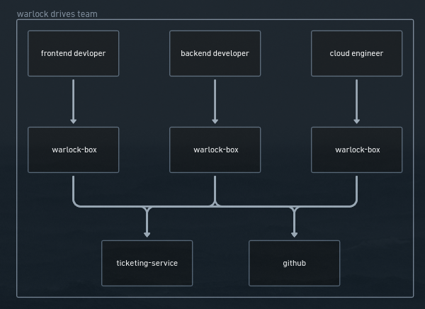
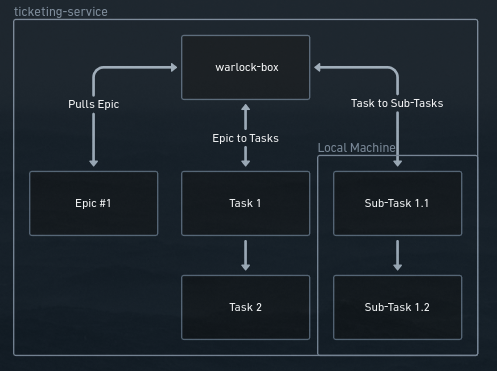
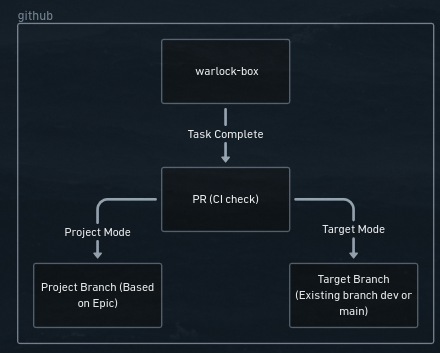
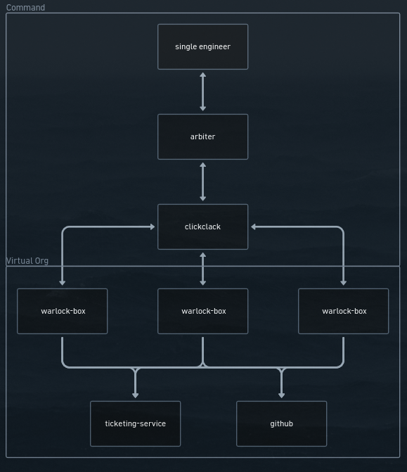

After Warlock's release I had the tools I needed to create software via AI, document the process, and have control.

I thought how would this work as with a team and I already extended the idea to a deployable warlock box which is a NixOS terraform repo for AWS.
The idea looked like the image below:

Each team member owns some part of a system as an individual and gets their own warlock box.
This box is accessible via the official Claude Mobile application.
This means each member of the team can create code by simply speaking on their phone with text-to-speech with Claude.

For some more details here's a zoom in of what the ticketing service behavior looks like.

Large chunks of work are pushed as Epics or Projects.
They are later pulled and turned into tickets.
When a ticket is worked on it is locally cut into subtasks and worked on with a fresh context window.
The sub-tasks do exist on the ticket though so anyone could reattempt sub-task work, only the working is local.

I'll dive into the GitHub modes available, this is important for the next jump in Warlock.

There is target branch mode and project branch mode.
Target branch means a team can make Epics, turn them into tickets, and each individual ticket is a PR waiting to be merged into the target branch, let's say "dev" for example.
Project branch mode means all tickets for an Epic or Project get a single unique branch where all related PRs merge into and then later a human can merge this project branch into "main" for example.
This is important because Project Branch mode allows for an interesting higher level feature.

Arbiter.
What if you could control an entire Org as a single person.
This is untested and just an idea at the moment but it should work as well as the individual parts work.
Some things to consider:
- How does Arbiter communicate to the boxes, I just put open claws clickclack as a placeholder.
- Do we even need multiple boxes? I suppose it's based on Org scale and instance hardware, we may be able to collapse multiple different slices into one EC2 instance and just pretend it's multiple.
- This is possible, it's just how sustainable? E2E testing will need to be manual to some degree and it varies by software being created, if a Test Oracle could be created for some of these it would greatly reduce operator overhead.

Using Project Branches means various teams real or virtual can create features at the same time into in many repos or a monorepo at once without overlap.
A human must jump in an manually merge a completed Project Branch to change final code state.

It's just a goofy idea at the moment but it seems possible and I want to try to build it out.
The issue is it's just LARPing organization structure as one person but I think all the process from the PRs and ticketing service have value and if used in a medium to small company could be pretty powerful.

